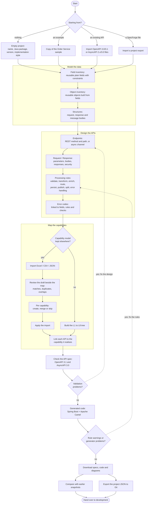
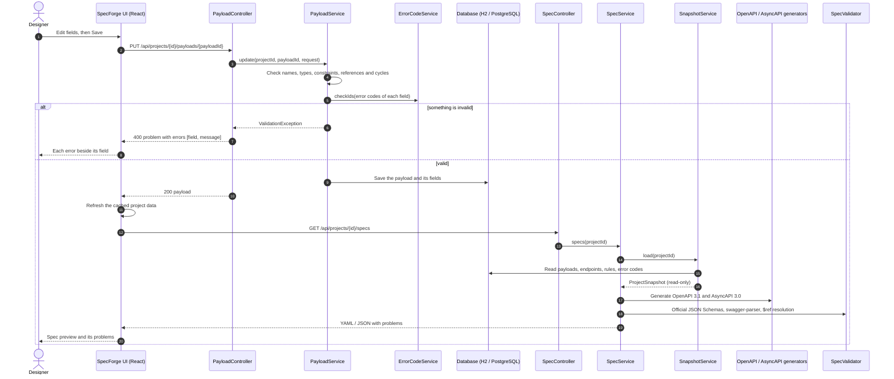
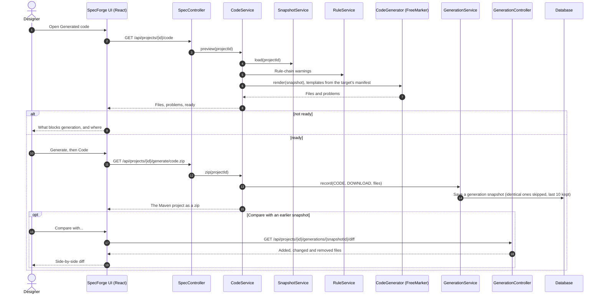
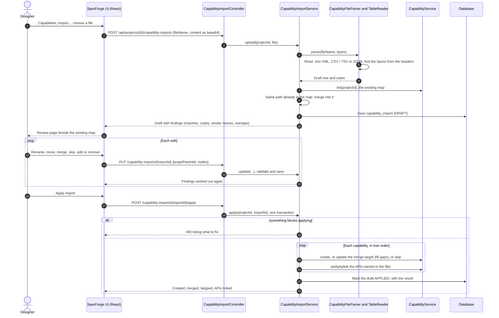
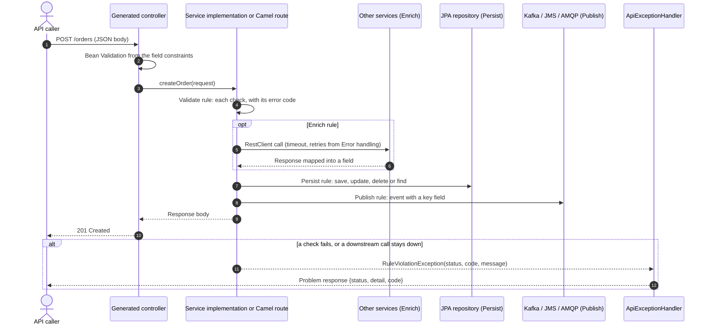
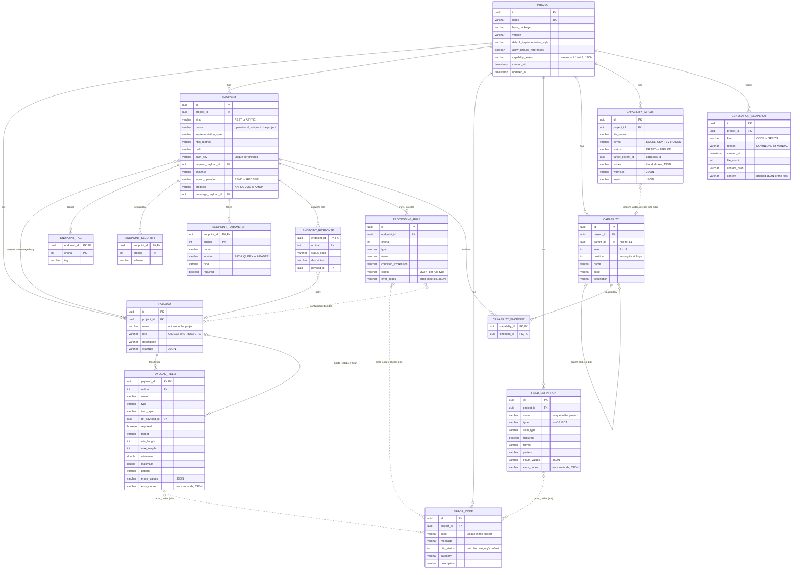

# SpecForge diagrams

Three views of SpecForge itself:

1. **Workflow:** how you go from an idea (or an existing spec) to generated code.
2. **Sequence diagrams:** what happens between the browser, the backend and the database in the main tasks.
3. **Entity relationships:** the database tables and how they refer to each other.

The diagrams are written in Mermaid, so GitHub and the app's **User guide** page draw them. To change one,
edit the text below. For the tasks themselves, see the [user guide](USER_GUIDE.md).

---

## 1. Workflow

From a new project to generated code. A diamond is a decision; a dashed arrow means going back to fix
something.

---

## 2. Sequence diagrams

### Save a design change and see the spec

Every save goes through the same validation, and the specs are generated fresh from the saved project.

### Generate and download the code

Generation is blocked while anything is wrong. Each download is kept as a snapshot to compare with later.

### Import capabilities from a spreadsheet

The file becomes a saved draft. Nothing in the capability map changes until the draft is applied.

### A request to the generated service

What the generated Spring Boot project does at run time for a REST endpoint built with processing rules.
It's shown here because it is what the design produces.

---

## 3. Entity relationships

The database tables (Flyway migrations in `backend/src/main/resources/db/migration`).

- **Solid lines** are foreign keys. Deleting a project deletes everything in it.
- **Dashed lines** are references kept as ids inside a JSON column. They have no foreign key; the services
  keep them consistent, for example by removing a deleted error code from every field, rule and check.
- **Element tables** (`payload_field`, `endpoint_tag`, `endpoint_security`, `endpoint_parameter`,
  `endpoint_response`) are ordered lists, keyed by their owner and an `ordinal`.

